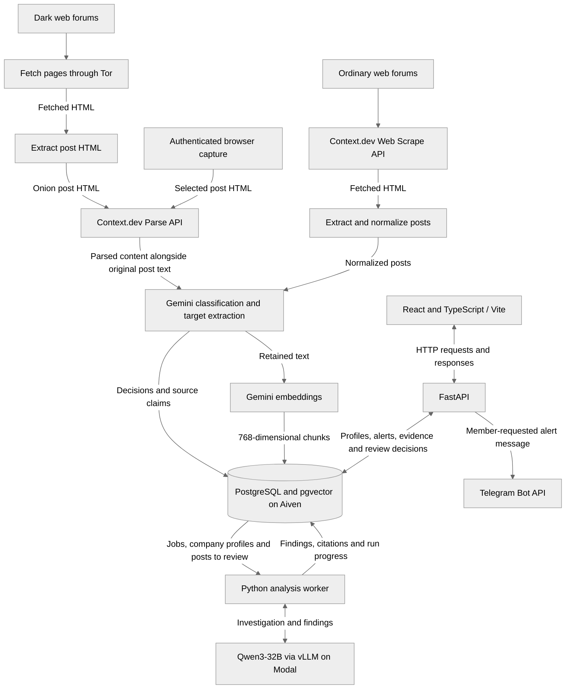
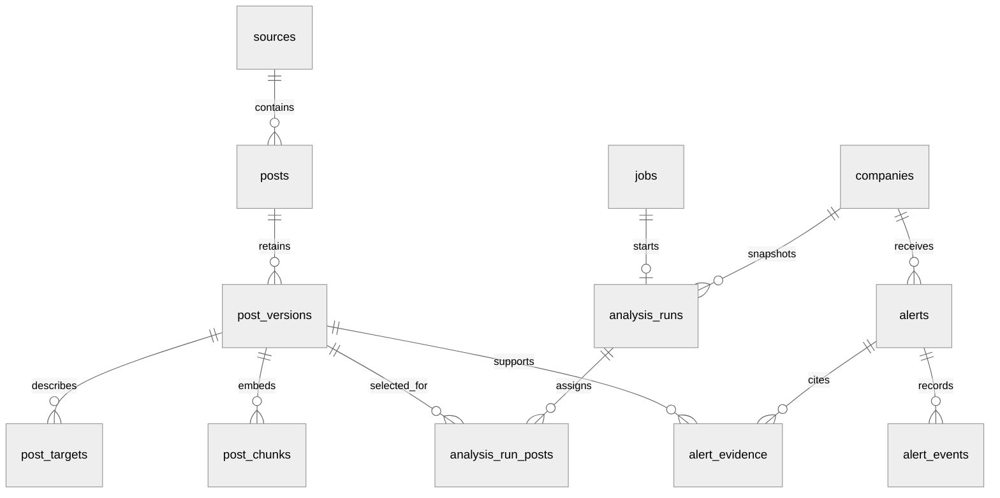

# scout.dev

[Watch the demo video](https://youtu.be/4Q6Ukd_Ed4Y)

scout.dev collects posts from dark web forums and identifies threats that may affect a company. It looks for leaked credentials, stolen data, and offers to sell access to company systems. Reviewers can inspect the original evidence, assess the findings, and send alerts to Telegram.

Dark web sites use addresses such as `.onion` that require Tor to access. scout.dev fetches these pages through Tor and passes post HTML to Context.dev for extraction. It also supports ordinary websites, bringing both sources into the same review workflow.

The interface is built with React and TypeScript. FastAPI serves the API. A separate Python worker handles collection and analysis. PostgreSQL with pgvector stores the application data, job queue, and search embeddings. The project uses Aiven for hosted PostgreSQL.

## How it works



Tor retrieves the pages. Context.dev parses the collected post HTML. The collector keeps the original post text for evidence and passes it to classification alongside the parsed content.

The intended architecture separates collection, analysis, and review. Dark web collection uses Tor to fetch forum pages, then source-specific selectors to extract individual posts. Context.dev parses the post HTML. Each forum needs its own collection configuration. The current collector supports onion sources that do not require authentication.

Ordinary web forums provide additional coverage through Context.dev’s web scraping API. Authenticated browser captures can also enter the same pipeline.

Context.dev’s extraction accompanies the normalized post during classification. The original post text remains the source for quoted evidence.

Gemini filters posts and extracts claims with supporting quotes before company matching. It is instructed to leave unknown attributes empty. Claims about different companies are stored separately, even when they appear in the same post.

We use Gemini for the first pass to keep collection responsive and limit the tokens spent on deeper analysis. A single request classifies each post and extracts claims with supporting quotes. This step uses a low thinking setting. Unrelated posts are filtered out before embedding and company analysis, leaving Qwen to investigate the retained material. Saved decisions are reused when the same content is collected again.

Retained text is split into chunks and embedded for search. The analysis layer is designed around Qwen3-32B, an open-weight model served through vLLM on a Modal H100. A Python worker gives the model a company profile and posts to investigate.

Analysis can retrieve related posts and inspect existing alerts through application tools. Findings include matching, conflicting, and missing attributes, along with citations. The service validates results before writing them. The UI shows those findings, original post text, and review history.

Members can send the newest company alert or resend a specific alert to the configured Telegram chat. Each click attempts to send a new message.

## Database design

The schema combines relational keys and constraints with JSONB documents. Company profiles, source configuration, normalized posts, and findings use JSONB. Fields used for filtering, ordering, or identity also have typed columns. Database access uses parameterized SQL through psycopg.

The initial [schema](threat_monitor/storage/schema.sql) and numbered migrations in the same directory define the current structure. The following diagram shows the core relationships. Scheduling and cache tables are described separately.



### Post identity, history and evidence

A post has a stable identity within its source. The unique key is `(source_id, source_key)`. Versions are deduplicated by `(post_id, content_hash)`, so collecting unchanged content does not create another version.

`posts.current_version_id` points to the currently observed version. Its composite foreign key includes the post ID, which prevents the pointer from referencing another post. A head revision changes when the current version changes. The observation timestamp prevents an older fetch from replacing a newer observation.

Historical source content remains available for citations. Target extraction and embedding metadata can be filled in later without replacing that source text. `ingestion_records` separately records keep/discard decisions and errors, including posts that were not retained.

`post_targets` holds separate sets of claims from each version. Target filters are combined within one target record. This avoids matching one victim's country with another victim's employee count.

Alerts belong to a company. Their identity combines the finding category with the stable source post behind the primary citation. Edited versions can therefore update an existing alert without creating a new alert identity. `alert_evidence` links exact quotes to specific post versions. `alert_events` records review transitions, actors, reasons, and evidence. Updating a finding does not automatically reopen a resolved alert.

### Search

`post_chunks` stores text offsets, chunk text, the embedding model, and a `vector(768)` embedding. Chunks are retained for historical post versions. Re-embedding a version replaces its existing chunks; the database does not archive every embedding model output. `current_search_chunks` is a separate, rebuildable table containing vectors for current post versions. It is maintained by application transactions, rather than a PostgreSQL materialized view refresh. Composite foreign keys tie each row to its post version and original chunk.

[Retrieval](threat_monitor/storage/search.py) combines PostgreSQL full-text search with vector similarity:

- A GIN expression index covers the title and body using the `simple` text-search configuration. Queries use `websearch_to_tsquery` and `ts_rank_cd`.
- Vector search uses cosine distance. Searches over history or small filtered sets use exact scoring. A materialized CTE keeps these queries on the exact path.
- Larger searches over current versions use an HNSW index with iterative scanning. The search retrieves additional chunks when several results belong to the same post.
- Results from both searches are combined. Each post is ranked by the sum of its best chunk similarity and its full-text score. Limits on the number of retrieved results bound the work per request.

Investigation searches run in a repeatable-read transaction so their internal queries see a consistent snapshot. Each pagination request gets a new snapshot. Unranked browsing uses a sequence cursor; ranked search uses an offset into its results.

The HNSW index is created separately with `CREATE INDEX CONCURRENTLY`, outside the schema migration transaction. The maintenance command can also rebuild the current-vector projection.

### Scheduling and consistency

| Tables | Purpose |
| --- | --- |
| `jobs`, `collection_threads` | Persist work state, collection checkpoints, and threads to revisit. |
| `analysis_runs`, `analysis_run_posts` | Capture the company/model snapshot and assigned post versions, including processed or superseded assignments. |
| `pending_analysis_changes` | Track changed post heads per company without losing deferred work. |
| `company_query_embeddings` | Cache query vectors by company, profile version, and embedding model. |
| `company_analysis_budgets` | Track the daily review budget per company and UTC date. |
| `schema_migrations` | Record applied schema versions. |

A requested analysis reviews all searchable posts: current versions with embeddings for the configured model. Daily analysis concentrates on changed posts. Posts mentioning a configured company name, alias, or domain receive priority. A daily budget limits the remaining posts selected for review. The database records work waiting for embeddings or a later review, along with assignments replaced by newer post versions.

Job claims use row locks with `FOR UPDATE SKIP LOCKED`. A session advisory lock allows one worker process to own the database queue. Within that process it runs up to two collection jobs and one analysis job concurrently. Partial unique indexes prevent overlapping active collection jobs for one source and overlapping running analyses for one company.

Transaction advisory locks coordinate migrations and analysis publication. Row locks protect company updates and post-head changes. Analysis checks the captured profile version, model configuration, and post-head revision before processing or publishing results. Superseded assignments are recorded separately from reviewed versions. Older runs cannot silently replace newer findings.

Connections are opened per operation, with a per-event-loop concurrency limit of four. A semaphore enforces that limit. Migrations are applied transactionally under an advisory lock. The implementation is in the [storage package](threat_monitor/storage).

## Run locally

Use Python 3.12, uv, and Node.js 22.12 or newer. Run these commands from the repository root:

```bash
uv sync --locked
cp -n .env.example .env
npm ci --prefix ui
npm run build --prefix ui
```

Set `DATABASE_URL` to a PostgreSQL database with pgvector 0.8.0 or newer available, and set `API_KEY` to the shared member access key. Keep credentials in the untracked `.env` file. For an existing shared database, coordinate schema changes before running the migration command.

For the Qwen analysis architecture described above, set these values in `.env` before starting the API or worker. They override the analysis settings in the example file:

```dotenv
ANALYSIS_PROVIDER=modal
ANALYSIS_MODEL=Qwen/Qwen3-32B
ANALYSIS_MODEL_REVISION=9216db5781bf21249d130ec9da846c4624c16137
```

Set `MODAL_INFERENCE_URL` and `MODAL_INFERENCE_TOKEN` for an authenticated deployment of [the Qwen service](threat_monitor/analysis/modal_app.py). It uses an H100 and an 8192-token context. Set `GEMINI_API_KEY` for classification and embeddings.

```bash
uv run --locked python -m threat_monitor.storage.db
uv run --locked python -m threat_monitor.storage.search_admin index
uv run --locked python -m threat_monitor.api
```

Open [localhost:8000/app/](http://localhost:8000/app/). The API serves the built frontend. API documentation is at `/docs`. In another terminal, start the worker when collection or analysis should run:

```bash
uv run --locked python -m threat_monitor.worker
```

The API can display existing data without a running worker. To collect new posts, register a source through `POST /sources` and request collection through `POST /collection-runs`. The schemas are available in `/docs`. Both endpoints require the member key in the `X-API-Key` header. Each source needs selectors for its forum layout.

| Configuration | When needed |
| --- | --- |
| `DATABASE_URL`, `API_KEY` | API and member access. |
| `GEMINI_API_KEY` | Post classification and embeddings. |
| `CONTEXT_DEV_API_KEY` | Web collection, onion post extraction, and browser capture parsing. |
| `TOR_SOCKS_PROXY` | Onion collection, usually `socks5h://127.0.0.1:9050`. |
| `ANALYSIS_PROVIDER`, `ANALYSIS_MODEL`, `ANALYSIS_MODEL_REVISION` | Select Qwen with the settings above. |
| `MODAL_INFERENCE_URL`, `MODAL_INFERENCE_TOKEN` | Access to the deployed Qwen service. |
| `AIVEN_TOKEN` | Optional Aiven setup helper, not normal API or worker operation. |
| `GUEST_ACCESS_ENABLED` | Optional read-only guest browsing. |
| `TELEGRAM_BOT_TOKEN`, `TELEGRAM_CHAT_ID` | Member-requested Telegram messages. |

Company selection organizes a shared workspace. It does not provide tenant isolation. Member access uses a shared key stored in browser tab session storage. Guest requests are restricted by the API.
